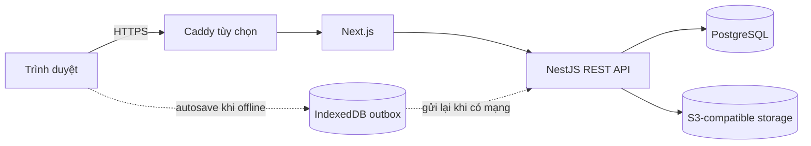

# Kiến trúc MeoTDC

## Các thành phần đang chạy

| Thành phần | Trách nhiệm | Lưu trữ hiện dùng |
|---|---|---|
| Next.js App Router | Giao diện bốn vai trò, proxy `/api/*`, IndexedDB outbox cho autosave bài thi | localStorage cho dữ liệu demo; IndexedDB chỉ chứa câu trả lời đang chờ gửi |
| NestJS REST API | Đăng nhập, phân quyền, đề, phiên thi, chấm, giám sát và nhận tệp | API không bật PostgreSQL thì dùng JSON local và bộ nhớ tiến trình |
| PostgreSQL | Snapshot runtime có khóa giao dịch, roster, phiên, rate limit, nonce, metadata tệp | Bật bằng `DATABASE_URL`; schema áp dụng tự động khi API khởi động |
| S3-compatible storage | Tệp bài tập riêng tư, ví dụ MinIO hoặc dịch vụ S3 | Bật bằng `S3_BUCKET`; nếu không, local demo ghi filesystem |
| ClamAV | Quét nội dung tệp trước khi lưu | Production yêu cầu scanner; Compose bật container ClamAV |
| Redis | Dịch vụ sẵn trong Compose để thử nghiệm sau | Chưa được luồng API/worker sử dụng |
| Caddy | Reverse proxy và TLS tự động khi bật profile `public` | Domain và origin do người triển khai cấu hình |

## Vòng đời bài thi

1. Giảng viên tạo đề; API kiểm tra dạng câu hỏi, đáp án, giới hạn, lớp/MSSV và mật khẩu rồi lưu bản có thể xuất bản.
2. Sinh viên xác thực phiên, bắt đầu lượt thi, xác nhận thông tin cần khai báo và nhận token cùng deadline/câu đã rút. API không gửi đáp án chuẩn.
3. Mỗi lần trả lời được lưu cục bộ trước, sau đó xếp trong IndexedDB và gửi lên API theo số phiên bản tăng theo thời gian. Hàng đợi đồng bộ lại mỗi 5 giây/khi trình duyệt online.
4. API kiểm tra quyền, thời hạn, token và sequence; chấm khách quan, giữ bài tự luận để giảng viên chấm. Giao diện chỉ nhận điểm đúng chính sách công bố.
5. Sự kiện giám sát được đóng dấu giờ nhận từ API. Các sự kiện vẫn do trình duyệt phát sinh, không phải bằng chứng độc lập.

## Giao dịch runtime và giới hạn tải

Migration `002_runtime_persistence.sql` tạo một JSONB snapshot cho đề/lượt thi. Mỗi thao tác reload snapshot trong PostgreSQL transaction và giữ advisory lock chung trước khi lưu. Điều này tránh hai API instance ghi đè state của nhau, nhưng tuần tự hóa cả heartbeat, autosave và lượt đọc. Đây là cấu hình bền vững cho demo/pilot ít người; chưa phải kiến trúc chịu tải đồng thời 5.000 sinh viên. Muốn dùng kỳ thi lớn, cần chuẩn hóa `exams`, `attempts`, `attempt_answers`, chuyển mỗi mutation sang khóa theo attempt, rồi benchmark và review migration.

Các bảng ở `001_init.sql` mô hình hóa trường/khoa/lớp/học phần, câu hỏi, phiên bản đề và attempt nhưng chưa là repository CRUD chính của runtime. Không được mô tả hệ thống hiện tại là đã kết nối roster hoặc SSO chính thức của TDC.

## Xác thực và quyền

- Cookie phiên `HttpOnly`, `SameSite=Lax`; DB chỉ lưu hash cookie. Password roster dùng scrypt + salt; token lượt thi lưu hash.
- Google ID token được xác minh bằng khóa công khai, audience, issuer, thời hạn, email xác minh và nonce dùng một lần. Trong production, email admin/giảng viên/nhà trường phải khớp allowlist; sinh viên cần trùng roster.
- Role allowlist chỉ là cầu nối tạm cho pilot; cần tích hợp IdP/SSO và nguồn roster/ghi danh TDC trước khi thi chính thức.
- Phân quyền tệp hiện theo vai trò/chủ tệp; chưa kiểm tra đầy đủ giảng viên có thuộc lớp của bài nộp hay không.

## Tệp và nhập nội dung

Tệp nộp bài được giới hạn 10 MB, phần mở rộng và chữ ký MIME được kiểm tra, sau đó quét bằng giao thức ClamAV INSTREAM trước khi lưu; production fail-closed nếu scanner không cấu hình hoặc không phản hồi. S3 bucket mới tạo là private. Docker/ClamAV chưa chạy xác minh ở máy phát triển này; cần xác minh antivirus signatures, false positives, timeout, restore và retention trong UAT. Chưa có quy trình xóa file theo thời hạn.

Nhập đề DOCX/PDF/TXT hiện đọc trực tiếp trong request và đưa bản nháp cho giảng viên rà soát; chưa có OCR, job queue, dead-letter, parser kiểm tra mọi bố cục hoặc worker độc lập. Redis đang có trong Compose nhưng chưa nối vào luồng.

## Triển khai và vận hành

- **Local demo:** `pnpm dev`; không cần DB, dùng JSON/bộ nhớ và demo accounts.
- **Stack PostgreSQL:** `Copy-Item .env.example .env`, đặt secret và OAuth, rồi chạy `docker compose up --build -d`. API tự áp dụng migrations; PostgreSQL/MinIO chỉ expose cổng loopback.
- **Public pilot:** trỏ DNS vào máy chủ, cấu hình `MEOTDC_DOMAIN`, `MEOTDC_WEB_ORIGINS=https://<domain>`, `COOKIE_SECURE=true`, secret riêng mạnh, OAuth origins đúng; chạy `docker compose --profile public up --build -d` để Caddy cấp TLS.
- **Backup:** `scripts/backup.ps1` tạo dump PostgreSQL. Chưa có backup tự động, mã hóa dump, lưu bản ngoài máy, restore rehearsal, metrics/APM hoặc pipeline deploy/rollback.

Không đưa đề/điểm thật vào máy demo. TDC cần phê duyệt nguồn định danh, dữ liệu lưu, quyền truy cập, quy chế xử lý tín hiệu giám sát, lưu trữ/xóa, khôi phục, tải, bảo mật và khả năng truy cập trước khi pilot với dữ liệu thật.
