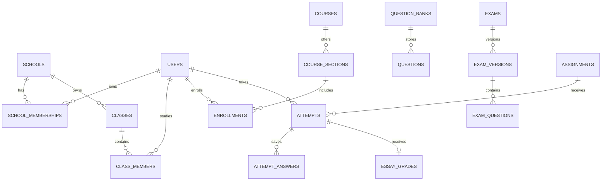

# Mô hình dữ liệu

Schema nền nằm tại `apps/api/database/001_init.sql`; migrations ứng dụng đang dùng nằm tại `apps/api/database/002_runtime_persistence.sql`, `003_learning_assignments.sql` và `004_learning_courses.sql`. `001` mô hình hóa bảng nghiệp vụ chuẩn của trường. Runtime hiện dùng PostgreSQL khi cấu hình `DATABASE_URL`, nhưng giữ đề/lượt thi trong một snapshot JSONB có advisory lock; bài tập/bài nộp và khóa học/tiến độ học đã dùng bảng riêng.

## Nhóm bảng

| Nhóm | Bảng | Ý nghĩa |
|---|---|---|
| Tổ chức | `schools`, `users`, `school_memberships`, `terms` | Trường, tài khoản, vai trò trong trường, học kỳ |
| Lớp/môn | `classes`, `class_members`, `courses`, `course_sections`, `enrollments` | Lớp hành chính, học phần, lớp học phần và ghi danh |
| Học liệu | `question_banks`, `questions`, `exams`, `exam_versions`, `exam_questions` | Ngân hàng câu hỏi, nội dung đề và phiên bản phát hành |
| Giao bài | `assignments`, `assignment_targets` | Lịch mở/đóng, số lần làm, đối tượng nhận bài |
| Thi/chấm | `attempts`, `attempt_answers`, `essay_grades`, `attempt_integrity_events` | Lượt thi, câu trả lời, chấm tự luận và tín hiệu giám sát có dấu thời gian máy chủ |
| Import/audit | `import_jobs`, `audit_events` | Tiến trình nhập file và nhật ký nghiệp vụ |
| Runtime hiện hành | `meotdc_runtime_state`, `meotdc_rate_limits`, `meotdc_google_nonces` | Snapshot đề/lượt thi và state chống ghi đè giữa API, bộ đếm rate limit, nonce dùng một lần |
| Tài khoản/phiên hiện hành | `meotdc_roster_accounts`, `meotdc_sessions` | Roster demo/pilot và phiên đăng nhập; session chỉ lưu hash cookie |
| Tệp hiện hành | `meotdc_submission_files` | Metadata file; nội dung nằm trong S3-compatible storage hoặc local demo |
| Bài tập hiện hành | `meotdc_learning_assignments`, `meotdc_learning_submissions` | Bài tập theo lớp, bài nộp, điểm, phản hồi và trạng thái yêu cầu sửa |
| Khóa học hiện hành | `meotdc_learning_courses`, `meotdc_learning_course_progress` | Nội dung khóa theo lớp và tiến độ hoàn thành riêng của từng sinh viên |

## Quy tắc dữ liệu

- Định danh dùng UUID; thời gian lưu `timestamptz` UTC. `users.auth_provider` phân biệt mật khẩu nội bộ, Google và SSO TDC; với Google, định danh ổn định là `auth_provider_subject` (`sub`), không phải email.
- Câu hỏi/đáp án cấu trúc dùng JSONB ở bản đầu; đáp án chuẩn không được trả trong endpoint student trước thời điểm công bố.
- `exam_versions` bất biến sau phát hành; lượt thi ràng buộc vào phiên bản cụ thể.
- `attempt_answers` có khóa duy nhất `(attempt_id, question_id)` và `client_sequence` đơn điệu để autosave idempotent.
- `attempts` chụp họ tên, MSSV, ngành và email tại thời điểm dự thi để lưu thông tin sinh viên khai trước bài; tài khoản SSO/roster là định danh chính, còn trường khai báo phải đối chiếu và có audit khi sửa.
- `assignments.audience` phân biệt giao theo lớp với bài luyện tập mở yêu cầu tài khoản Google xác minh. Bài thi chính thức vẫn cần API kiểm tra ghi danh và quyền bắt đầu lượt ở server.
- Index phục vụ truy vấn theo `school_id`, `class_id`, `course_id`, `assignment_id`, `user_id`, trạng thái và thời gian.
- Dữ liệu điểm/thành viên nên áp dụng quyền theo trường và chính sách lưu trữ được TDC phê duyệt.

## ERD giản lược

## Lưu ý tải lớn

Không partition bảng từ đầu khi chưa có số liệu. Nếu `attempt_answers` tăng nhanh, theo dõi dung lượng/index, cân nhắc partition theo kỳ thi hoặc thời gian sau khi kiểm tra ảnh hưởng tới unique keys và migration. Dùng connection pool; truy vấn dashboard tổng hợp cần pagination và cache có TTL. Cần benchmark trên dữ liệu giả lập có phân bố giống học kỳ thật.

Kho snapshot runtime đang khóa toàn cục theo transaction; nó ngăn lỗi ghi đè giữa nhiều instance nhưng tuần tự hóa mọi thao tác và không phải lựa chọn cho 5.000 lượt thi đồng thời. Bước cần làm trước khi mở kỳ thi lớn là migration dữ liệu sang `exams`/`exam_versions`/`attempts`/`attempt_answers`, khóa theo attempt và benchmark nộp bài/heartbeat trên tải giả lập. Migrations hiện được chạy tự động bởi API và có bảng version `meotdc_schema_migrations`.
